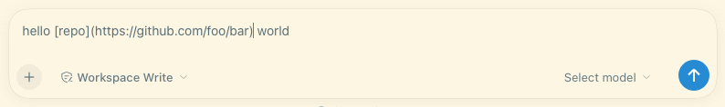
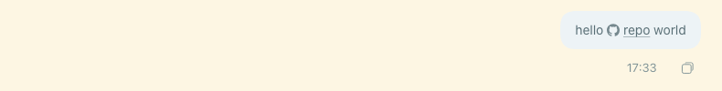

# dsh-link-plugin

One small DSH browser plugin for links: **paste a URL over selected composer
text** and **render Markdown links in sent user messages**.

Rebuilt 2026-10-24 (version 0.3.0) as a link-only plugin after the previous
version — a 50k-line fork of the `dsh-markdown-input` composer takeover — was
disabled by DSH's compatibility check when the app upgraded from `0.2.1-rc.2`
to `0.2.1-rc.3` (it pinned `engines.dsh: "0.2.1-rc.2"` exactly, so the whole
bundle was skipped at startup). The takeover composer is gone; the two link
features are now built only on DSH's documented extension surfaces.

## What it does

1. **Paste a URL over selected text** — select `repo` in the DSH composer,
   press `Cmd/Ctrl+V` with `https://github.com/…` on the clipboard: the
   selection becomes `[repo](https://github.com/…)` as one undoable edit.
   Plain text, non-URL pastes, image/file pastes, and pastes outside the
   composer are untouched. If the host refuses the edit, the native paste
   happens instead (nothing is swallowed).
2. **Links in sent user messages** — a user message containing
   `[repo](https://github.com/…)` renders the link as a small site icon plus
   an underlined `repo` label (GitHub, npm, GitLab, YouTube, X, Figma,
   Notion, Bilibili, Zhihu, Wikipedia, LinkedIn, Google, Reddit, Discord,
   Telegram, WeChat, Stack Overflow, Medium, Hugging Face, Substack — other
   hosts get a generic link glyph). In a sent bubble it is a normal external
   anchor; queue previews show a static span. Model input and copy/clipboard
   keep the Markdown source.

## Why it should survive DSH upgrades

The old breakage was structural, not a bug in one line. The new design removes
the coupling that made every host update a porting project:

| Risk in the previous build | What this build does instead |
| --- | --- |
| Exact `engines.dsh` pin → DSH's compatibility preflight **skips the whole bundle** on any version change | No `engines.dsh` and no `@deepseek-ai/dsh*` peer dependencies at all. The preflight can never disable it; the plugin loads and checks at runtime. |
| 1.9 MB fork of the host composer (CodeMirror takeover + host React primitives) | 43 KB hand-written bundle, **no `require()` of host client packages**; React from the browser seed table is the only import. |
| Leaning on host components (`LinkIconMedium`, `UserTextRun`) that change without notice | Own inline SVG icons and markup; styling uses theme tokens / `currentColor`, so a renamed token only changes appearance. |
| One import error killed every feature and could blank the composer | Two features register independently and are each guarded; a missing service or slot disables that feature only and prints a clear `[dsh-link-plugin]` warning. |

Only these documented host surfaces are used (all verified against DSH
`0.2.1-rc.3`):

- `conversation.input.overlay` list slot (composer) + its standard
  provide-channel props `useInput` / `inputActions.captureInsertion()` /
  `inputActions.insertText()`;
- `uiConversation.userText.register()` rule registry;
- `conversation.user.text.node` keyed slot.

If DSH ever renames one of them, `tools/compat-check.mjs` says which one, the
plugin keeps working for everything else, and the fix is one small guarded
registration in `lib/client.js` — not a rebase of a 50k-line fork.

## Target / compatibility

- Built and tested against **DSH `0.2.1-rc.3`** (macOS desktop). The plugin
  declares no upper version bound by design; drift is detected, not assumed.
- Runs on the native DSH composer. There is intentionally **no live
  Markdown-rendering composer takeover** in this version.
- User messages render *inline links* only — other Markdown (`**bold**`,
  headings, code blocks) stays plain text in user bubbles.
- Composer links are not clickable while editing; sent-bubble links open in a
  new window.

## Install into a profile

```sh
cp -R <this-dir> ~/.dsh/profiles/<profile>/plugins/dsh-link-plugin
# ~/.dsh/profiles/<profile>/package.json:
#   "dependencies": { "dsh-link-plugin": "file:./plugins/dsh-link-plugin" }
#   "dsh": { "profile": { "bundles": [ ..., "dsh-link-plugin" ] } }
cd ~/.dsh/profiles/<profile> && pnpm install
```

Or ask the DSH agent to install this directory as a bundle
(`plugin_manager` → `install_bundle` with the absolute directory) — that path
handles the package and profile copy for you.

> **Replacing an existing install:** the profile keeps its own copy of the
> package under `node_modules/`. pnpm can consider an unchanged `file:` spec
> "already up to date" and leave that stale copy in place, so after
> editing/replacing the plugin directory use the precise refresh:
>
> ```sh
> cd ~/.dsh/profiles/<profile>
> rm -rf node_modules/dsh-link-plugin && pnpm install
> ```
>
> A stale copy keeps loading old JavaScript and is exactly what
> `tools/compat-check.mjs` flags.

## Verification

```sh
node tests/smoke.mjs            # dependency-free unit/smoke test
node tools/compat-check.mjs     # after every DSH app update; see below
```

`tools/compat-check.mjs` reads the installed DSH app (default
`/Applications/DeepSeek Harness.app`, override `--app` / `DSH_APP`, or
`--host-modules <dir>` for npm installs) and checks:

- the DSH runtime version and the plugin manifest (an exact version pin is a
  hard FAIL — that is the failure mode this rewrite removes);
- the host client surfaces above, searched in the installed conversation /
  chat / renderer / web-shell bundles;
- that `lib/client.js` imports no host client packages;
- whether the profile's installed copy is stale compared with the repo.

Exit code 0 = PASS (or PASS with warnings), 1 = FAIL with the exact missing
surface. Run it right after a DSH update; it is the “did the host move under
us?” alarm.

The real end-to-end check (paste + Enter + sent-bubble render on DSH
`0.2.1-rc.3`) was run on 2026-10-24 in an isolated `dsh web` instance with
headless Chrome over the Chrome DevTools Protocol: **15/15 assertions passed**
(plugin row in the boot graph, no compatibility-skip line, clean console,
paste-to-link in the composer, brand-icon link in the sent bubble, generic
icon for unknown hosts, native fallback for non-URL pastes). Screenshots:





Re-run the same flow after a host update if `compat-check` reports a warning;
the harness and its instructions live in [`tests/e2e/README.md`](tests/e2e/README.md).
It is developer tooling only and is not shipped inside the plugin package.

## Upgrade procedure after a DSH update（中文）

1. 更新 DSH 后运行 `node tools/compat-check.mjs`。
2. **PASS** → 插件继续工作（不会再因为版本号被 DSH 直接禁用）。
3. **MISSING xxx** → 只列出宿主改了哪个接口；插件仍能加载，受影响的功能会自我禁用并在控制台打印
   `[dsh-link-plugin]` 警告，不会白屏、不会拖垮输入框。按报告改 `lib/client.js` 中对应的一个注册点即可。
4. 如果改过 `lib/client.js`，在 profile 目录执行 `rm -rf node_modules/dsh-link-plugin && pnpm install`
   刷新副本（只跑 `pnpm install` 可能被判为“已是最新”而跳过）；`compat-check` 会检测“profile 里还是旧代码”。

## File map

| Path | Role |
| --- | --- |
| `lib/client.js` | Browser half: both features, hand-written lazy-CJS bundle (no build step). |
| `lib/index.js` | Host half: inert ESM no-op required for bundle discovery. |
| `cordis.patch.yml` | Bundle patch: inserts the enabled Loader row. |
| `tests/smoke.mjs` | Dependency-free harness (fake module table/React/ctx). |
| `tests/e2e/` | Developer-only real-UI acceptance harness (isolated `dsh web` + headless Chrome CDP); not shipped. |
| `tools/compat-check.mjs` | Post-upgrade host-surface verifier. |
| `docs/verify/` | Screenshots from the last end-to-end run. |
| `archive/takeover/` | Historical 0.2.x takeover fork + rebuild scripts (not shipped; kept for provenance and possible future reuse). |

## License

MIT for this plugin. Brand glyph path data is from [Simple Icons](https://simpleicons.org/)
(CC0 1.0). The archived takeover build retains its upstream MIT notices; see
`THIRD_PARTY_NOTICES.md`.
